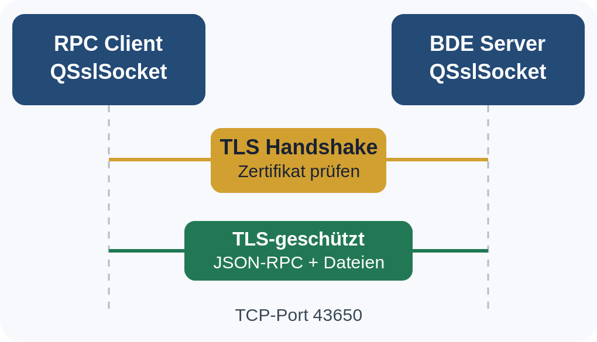

# PythonBDE – RPC-Verbindung mit TLS schützen

Für deinen **PythonBDE Server v0.5.7** empfehle ich, TLS direkt in das bestehende Qt5-Netzwerkprotokoll einzubauen. Damit werden sämtliche JSON-RPC-Nachrichten verschlüsselt übertragen, ohne dass du dein bisheriges RPC-Protokoll neu entwickeln musst.

Ich habe den Quellcode von Version 0.5.7 geprüft. Momentan verwendet er:

- `QTcpServer` in `pythonbde/protocol.py`
- `QTcpSocket` in `rpc_client.py`
- JSON-Nachrichten mit `\n` als Trennzeichen
- Windows Secrets für den zusätzlichen Schutz von Anmeldepasswörtern unter Windows

**Die beste Lösung ist, `QTcpSocket` durch `QSslSocket` zu ersetzen und eingehende Serververbindungen unmittelbar mit TLS abzusichern.** Qt5 bietet diese Funktion bereits über `QtNetwork` an.

## 1. So funktioniert TLS bei PythonBDE



*[Dieselbe Grafik als skalierbares SVG](images/tls_architektur.svg)*

Der Ablauf ist dann:

1. Der RPC-Client verbindet sich mit dem Server.
2. Beide handeln TLS aus.
3. Der Client prüft das Serverzertifikat und den Hostnamen.
4. Erst nach erfolgreicher Prüfung beginnt das bestehende JSON-RPC-Protokoll.
5. Login, `CreateWindow`, `.cpy`-Module, Dateizugriffe und Servernachrichten laufen durch dieselbe verschlüsselte Verbindung.

TLS 1.3 sollte bevorzugt werden, TLS 1.2 kann als Mindestversion für Kompatibilität dienen. Die Python- und Qt-Dokumentation unterstützen diesen Ansatz.

Das bisherige TCP-Portschema kann erhalten bleiben:

```ini
[Server]
ip = 0.0.0.0
port = 43650

[TLS]
enabled = true
certificate = certificates/server.crt
private_key = certificates/server.key
```

Diese INI-Erweiterung ist ein Vorschlag für die Implementierung; in v0.5.7 werden die TLS-Einträge noch nicht verarbeitet.

## 2. TLS-Zertifikat erzeugen

Für einen ersten lokalen Funktionstest kannst du mit OpenSSL ein selbstsigniertes Zertifikat erstellen. Der Name beziehungsweise die IP-Adresse, mit der sich der Client verbindet, muss im Zertifikat als *Subject Alternative Name* (SAN) stehen.

Im Projektverzeichnis unter Windows:

```cmd
mkdir certificates
```

Anschließend:

```cmd
openssl req -x509 -newkey rsa:3072 -sha256 -nodes -days 365 -keyout certificates/server.key -out certificates/server.crt -subj "/CN=localhost" -addext "subjectAltName=DNS:localhost,IP:127.0.0.1"
```

Damit erhältst du:

```text
PythonBDE_Server/
 ├── server.py
 ├── rpc_client.py
 ├── pythonbde.ini
 ├── certificates/
 │    ├── server.crt
 │    └── server.key
 └── pythonbde/
      ├── protocol.py
      └── ...
```

`server.crt` ist das öffentliche Zertifikat. `server.key` ist der private Schlüssel und darf ausschließlich für den Serverdienst zugänglich sein.

Für einen Server im LAN solltest du ein Zertifikat mit dessen tatsächlichem DNS-Namen und gegebenenfalls den verwendeten IP-Adressen erzeugen. Für produktiven Einsatz empfiehlt sich eine eigene vertrauenswürdige Zertifizierungsstelle (CA) oder ein Zertifikat einer anerkannten CA.

## 3. TLS auf dem Qt5-Server

Für die Datei `pythonbde/protocol.py` benötigst du eine von `QTcpServer` abgeleitete Klasse, die anstelle gewöhnlicher TCP-Sockets verschlüsselte `QSslSocket`-Verbindungen erzeugt.

Eine mögliche Umsetzung ist:

```python
from pathlib import Path

from PyQt5.QtCore import pyqtSignal
from PyQt5.QtNetwork import (
    QTcpServer,
    QSslSocket,
    QSslCertificate,
    QSslKey,
    QSsl,
)


class TLSServer(QTcpServer):
    secureConnected = pyqtSignal(object)

    def __init__(self, certificate, private_key, parent=None):
        super().__init__(parent)

        if not QSslSocket.supportsSsl():
            raise RuntimeError("Qt5 TLS support unavailable")

        self.certificate = QSslCertificate(
            Path(certificate).read_bytes(),
            QSsl.Pem
        )

        self.private_key = QSslKey(
            Path(private_key).read_bytes(),
            QSsl.Rsa,
            QSsl.Pem,
            QSsl.PrivateKey
        )

        if self.certificate.isNull() or self.private_key.isNull():
            raise ValueError("Invalid TLS certificate or key")

        self._pending_sockets = set()

    def incomingConnection(self, descriptor):
        sock = QSslSocket(self)

        if not sock.setSocketDescriptor(descriptor):
            sock.deleteLater()
            return

        self._pending_sockets.add(sock)

        sock.setLocalCertificate(self.certificate)
        sock.setPrivateKey(self.private_key)
        sock.setProtocol(QSsl.TlsV1_2OrLater)

        sock.encrypted.connect(
            lambda s=sock: self._on_encrypted(s)
        )
        sock.disconnected.connect(
            lambda s=sock: self._pending_sockets.discard(s)
        )

        sock.startServerEncryption()

    def _on_encrypted(self, sock):
        self._pending_sockets.discard(sock)
        self.secureConnected.emit(sock)
```

Die entscheidende Stelle ist:

```python
sock.startServerEncryption()
```

Erst wenn das Signal `encrypted` ausgelöst wurde, darf der Server JSON-RPC-Anfragen bearbeiten.

In der vorhandenen Klasse `BDEServer` muss dazu die bisherige Methode `_accepted()` aufgeteilt werden: Die neue Verbindung wird nicht mehr über `nextPendingConnection()` abgeholt, sondern vom TLS-Listener nach erfolgreichem Handshake übergeben.

So können die bisherigen Methoden `_read()`, `_send()`, `_dispatch()` sowie die Sitzungsverwaltung weitgehend erhalten bleiben.

## 4. TLS im RPC-Client

In `rpc_client.py` wird aus:

```python
from PyQt5.QtNetwork import QTcpSocket

self.sock = QTcpSocket(self)
```

folgender Code:

```python
from pathlib import Path
from PyQt5.QtNetwork import (
    QSslSocket, QSslCertificate, QSsl
)

self.sock = QSslSocket(self)

if not QSslSocket.supportsSsl():
    raise RuntimeError("TLS unavailable")

# Vertrauenswürdiges Zertifikat für den Test
certificate = QSslCertificate(
    Path("certificates/server.crt").read_bytes(),
    QSsl.Pem
)

self.sock.addCaCertificate(certificate)
self.sock.setPeerVerifyMode(QSslSocket.VerifyPeer)
self.sock.setProtocol(QSsl.TlsV1_2OrLater)

# _connected() darf erst nach dem TLS-Handshake
# das JSON-hello senden.
self.sock.encrypted.connect(self._connected)
self.sock.readyRead.connect(self._read)
self.sock.disconnected.connect(self._disconnected)
self.sock.errorOccurred.connect(self._socket_error)
```

In `connect_login()` ersetzt du:

```python
self.sock.connectToHost(host, port)
```

durch:

```python
self.sock.connectToHostEncrypted(host, port)
```

Dabei muss `host` mit dem Zertifikat übereinstimmen.

**Wichtig:** Die alte Verbindung `self.sock.connected.connect(self._connected)` muss entfallen. Andernfalls würde der Client möglicherweise bereits JSON-Nachrichten senden, bevor TLS fertig ausgehandelt wurde.

Das Zertifikat muss vertrauenswürdig sein. Bei einem privaten Zertifikat musst du es über einen vertrauenswürdigen Weg auf den Client bringen. Keinesfalls solltest du Zertifikatsfehler pauschal mit `ignoreSslErrors()` umgehen.

## 5. Sicherheit der Verbindung prüfen

Nach der Umstellung kannst du den TLS-Server mit OpenSSL überprüfen:

```cmd
openssl s_client -connect 127.0.0.1:43650 -CAfile certificates/server.crt -verify_ip 127.0.0.1 -verify_return_error
```

Bei erfolgreicher Prüfung sollte unter anderem erscheinen:

```text
Verification: OK
Verify return code: 0 (ok)
```

Außerdem kannst du in der Server-GUI die ausgehandelte TLS-Version anzeigen:

```python
print(sock.sessionProtocol())
print(sock.sessionCipher().name())
```

Für den RPC-Client würde ich zusätzlich vor jeder ausgehenden JSON-Nachricht prüfen:

```python
if not self.sock.isEncrypted():
    raise ConnectionError("TLS connection required")
```

Damit gibt es auch bei einem Programmierfehler keinen unbeabsichtigten Rückfall auf Klartext.

## 6. Auswirkungen auf PythonBDE

| Funktion | Mit TLS |
|---|---|
| Benutzeranmeldung | Verschlüsselt |
| Windows Secrets | Optional zusätzlich |
| JSON-RPC-Befehle | Verschlüsselt |
| `CreateWindow` | Verschlüsselt |
| `.cpy`-Übertragung | Verschlüsselt |
| Virtuelles Dateisystem | Verschlüsselt |
| Datei-Uploads / Downloads | Verschlüsselt |
| Servernachrichten | Verschlüsselt |
| Zertifikatsprüfung | Erforderlich |

Die vorhandenen `.cpy`-Signaturen solltest du unbedingt beibehalten. TLS schützt den Transport, die Modulsignatur sichert zusätzlich die Herkunft der ausführbaren Module ab.

### Meine Empfehlung für die nächste PythonBDE-Version

Ich würde in Version **0.5.8** TLS fest integrieren und den Server-Settings-Dialog um eine neue GroupBox `TLS / SSL Security` erweitern.

Darin sollten ein Schalter `Enable TLS`, die Zertifikat- und Schlüsselpfade, eine Schaltfläche `Test Certificate` und eine Anzeige der verfügbaren TLS-Versionen vorhanden sein.

Im RPC-Client würde ich den Verbindungsstatus entsprechend erweitern:


*[Statusanzeige als SVG](images/tls_status.svg)*

Dagegen sollten unverschlüsselte Verbindungen im produktiven Netzwerkbetrieb vollständig abgewiesen werden. Die bisherige Passwort-Klartextwarnung wäre dann nicht mehr notwendig.

**Wichtig:** Die oben gezeigten Klassen sind die Grundlage für die Integration, noch kein vollständig in v0.5.7 eingebauter und getesteter Patch. Insbesondere müssen `BDEServer._accepted()`, der TLS-Verbindungsaufbau im Client und die Zertifikatsfehlerbehandlung noch miteinander verbunden werden.

Damit wäre PythonBDE erstmals nicht nur auf der Ebene einzelner Passwörter, sondern **über die gesamte RPC-Verbindung hinweg verschlüsselt und gegen das Einschleusen fremder Server durch Zertifikatsprüfung abgesichert**.

---

#### Weiterführende Dokumentation

- [Qt 5: QSslSocket](https://doc.qt.io/qt-5/qsslsocket.html)
- [Qt 5: QSslCertificate](https://doc.qt.io/qt-5/qsslcertificate.html)
- [Python-Dokumentation: ssl](https://docs.python.org/3/library/ssl.html)
