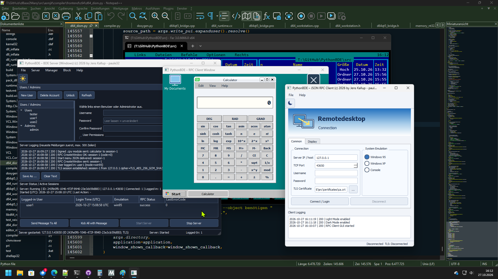

# PythonBDE – Qt5-BDE-Server mit DBF-Benutzerverwaltung



**Version 0.5.9** · eigenständige Erweiterung zu [paule32/PythonBDE](https://github.com/paule32/PythonBDE).
Der beim Abruf verfügbare Repository-Text beschreibt das Projekt als „python based BDE server“.
Die hier enthaltene Implementierung ist ein **neues, separates Grundmodul**; es wurde **nichts nach GitHub gepusht**.

## Neu v0.5.9 – TLS-Vertrauenskette korrigiert

Das fruehere TLS-Testzertifikat war ein selbstsigniertes Serverzertifikat (CA=False).
Qt5 konnte dessen Herausgeber deshalb unter Umstaenden nicht verifizieren.
`generate_tls_certificate.py` erzeugt jetzt eine private Root-CA (`ca.crt`, `ca.key`)
und ein davon unterschriebenes Serverzertifikat (`server.crt`, `server.key`).
Im Client **`ca.crt`**, nicht `server.crt` verwenden. Bei vorhandenen alten
Zertifikaten erst sichern und dann die neuen Dateien erstellen; keine
automatischen Ueberschreibungen. Siehe `TLS_SETUP.md`.

## Neu v0.5.8 – integriertes TLS für den Server und den RPC-Client

**In dieser Version ist der Netzwerktransport standardmäßig TLS-geschützt.**
Siehe **[TLS_SETUP.md](TLS_SETUP.md)** für die Zertifikatsgenerierung und den
Start auf Windows/Linux. Nach erfolgreicher Zertifikatsprüfung läuft die gesamte
JSON-RPC-Verbindung einschließlich Passwort, RDP-Fenster, Startmenü, `.cpy`-Paketen
und virtuellen Dateien über QSslSocket. Alte Abschnitte unten beschreiben
**historische Versionsstände** und deren damalige Klartextbeschränkungen.

Zum ersten Start zuerst `python generate_tls_certificate.py` ausführen;
anschließend `python server.py` und den Client mit
`python rpc_client.py --ca-cert certificates/ca.crt` starten.

## Neuerungen v0.5.7 – RDP-/DB-Konten und virtueller Dateiserver

Unter **Manager → Users → User Permissions** gibt es zwei sich gegenseitig
abschließende RadioButtons **Use as RDP** und **Use as DB**. Der Typ steht in
`ACCTYPE` in `users.dbf` (Werte `RDP` / `DB`), nicht im Passwort. Neue Konten
sind zunächst RDP-Konten. Vorhandene DBF-Dateien im Schema v0.5.6 können
weiter geöffnet werden; bestehende Konten gelten als RDP. **Vor dem ersten
Schreiben bitte eine Sicherung der `users.dbf` anlegen**, da dabei das neue
DBF-Schema mit `ACCTYPE` und `FSROOT` geschrieben wird.

Beim Login ist der Kontotyp verbindlich: `systemMode` `win95`, `winXP` oder
`con` erfordert RDP; für DB-Konten ist `systemMode: "db"`, `display: null`
vorgesehen. Beim DB-Login wird kein `CreateWindow` gesendet. Die eigentliche
DB-Tabellen-RPC-Engine ist **noch nicht** implementiert. Die existierenden
20-/60-Sekunden-Login-Regeln bleiben bestehen.

Der RDP-Dateiserver verwaltet ein privates Benutzerverzeichnis neben
`users.dbf` unter `user_data/<FSROOT>/`. `FSROOT` ist eine zufällige 32-stellige
hexadezimale Verzeichniskennung und wird **nicht** an Clients übertragen.
Eine serverseitige `filesystem.json` ist der autoritative virtuelle Index.
Die Startverzeichnisse `My Documents` und `Desktop` werden beim Anlegen eines
RDP-Kontos beziehungsweise vor dem ersten RDP-Login erstellt. Die Serverdateien
werden unter Linux mit `0700`/`0600`, unter Windows nach erfolgreicher
`icacls`-Zugriffsbeschränkung verarbeitet (bei ACL-Fehler Abbruch). Entfernte
Konten hinterlassen ihre Daten zunächst zur manuellen administrativen Sicherung;
neu angelegte Konten mit identischem Namen erhalten einen **anderen** FSROOT.

Neue, nur nach erfolgreichem RDP-Login zulässige JSONL-Befehle:

```json
{"action":"vfs_list", "path":"My Documents"}
{"action":"vfs_mkdir", "path":"My Documents/Briefe"}
{"action":"vfs_read", "path":"My Documents/Briefe/a.txt", "offset":0}
{"action":"vfs_begin", "path":"My Documents/Briefe/a.txt"}
{"action":"vfs_chunk", "content":"<base64>"}
{"action":"vfs_commit"}
{"action":"vfs_abort"}
```

Der Server prüft die angemeldete Sitzung und die aktuellen Rechte bei **jeder**
Dateianfrage: `READ` zum Auflisten/Lesen, `WRITE` für neue Dateien/Ordner,
`MODIFY` zum Überschreiben (Admin darf beides). Namen mit `..`, absoluten
Pfaden oder Windows-Laufwerksbezeichnern sowie Symlinks werden abgelehnt;
Dateien außerhalb des Index können nicht gelesen werden. Die Übertragung
verwendet Base64-Blöcke bis 20 KiB und maximal 16 MiB pro Datei.

Im RPC-Client wird der Datei-Dialog als `QMdiSubWindow` **innerhalb des
Arbeitsfensters** angezeigt: links `My Documents`/`Desktop`, rechts Dateitabelle,
Navigation und `New Folder`, darunter Pfadeingabe und Filter je Anwendung.
Notepad/WordPad lesen/schreiben über diesen JSON-RPC-Dienst statt über ihre
bisherigen lokalen `QFileDialog`-Pfade. WordPad druckt formatierten Inhalt
über einen internen Drucker-Auswahldialog; die About-Fenster sind ebenfalls
interne MDI-Fenster. Zusätzlich öffnet das verschiebbare **My Documents**-Icon
links oben eine erste Explorer-Ansicht. Das verschiebbare Disconnect-Icon wird
rechts oben platziert. Beide bleiben in der Desktop-Ebene hinter Modulfenstern.

**Wichtige Sicherheitsgrenzen:** Ein RDP-Server-Dateisystem schützt die Dateien
gegen nicht autorisierte **Protokollanfragen**, stellt aber **keine Sandbox**
für den signierten, auf dem Client ausgeführten Python-Code dar. Andere
Prozesse mit derselben Betriebssystemidentität wie der Server können trotz
privater Dateirechte lokal Zugriff haben. Für LAN-Verbindungen unbedingt
TLS/VPN einsetzen: auch die Datei-Inhalte und Metadaten sind derzeit nicht
durch Ende-zu-Ende-TLS geschützt. Windows-NTFS-ACLs, echtes Qt5-MDI-Verhalten
und die Druckausgabe müssen nativ getestet werden.

**Tests:** 253 automatisierte Tests unter Linux; inklusive 10 neuer Tests für
virtuelle Verzeichnisse/Dateien, Pfadvalidierung, Benutzerisolation,
DBF-Rückwärtskompatibilität und den DB-/RDP-Protokollmarker.

## Neuerungen v0.5.6 – Notepad und WordPad als Remote-Anwendungen

Der bisherige Notepad-Dummy wurde durch einen eigenständigen **QPlainTextEdit**-
Texteditor ersetzt. **WordPad** ist neu als zusätzliches freigegebenes Modul
unter `Programs → Accessories → WordPad` verfügbar. Beide kommen **nicht** als
native Windows-EXE-Dateien, sondern als vom Server kompiliertes, Ed25519-signiertes
`.cpy`-Paket über die vorhandene `load_module`-RPC-Verbindung zum Client.

- **Notepad:** File → New/Open/Save/Save As/Print/Exit, Edit → Undo/Redo,
  Cut/Copy/Paste/Delete, Find/Find Next/Replace/Go To, Select All, Time/Date;
  Format → Word Wrap/Font; View → Status Bar und Zoom. UTF-8, UTF-8-BOM,
  UTF-16 BOM, CP1252-Fallback und bestehende CRLF/LF/CR-Zeilenenden.
- **WordPad:** Rich-Text-Ansicht in QTextEdit mit ToolBar für Schriftart, Größe,
  Fett/Kursiv/Unterstrichen/Durchgestrichen, Textfarbe, Ausrichtung sowie
  Aufzählungen/Nummerierung. File → New/Open/Save/Save As/Print, Suche und
  Ersetzen, Einfügen von Bildern sowie Datum/Uhrzeit. Unterstützte Formate:
  `.rtf` (gängige Text-, Zeichen- und Absatzformatierung), `.html`, `.txt`;
  `.odt`-Export via Qt, ODT-Import von Basistext.
- **Dateien werden auf dem Clientrechner** über explizite Qt-Dateidialoge
  geöffnet/gespeichert, nicht automatisch im Server-Datenverzeichnis.
  Geänderte Dokumente lösen beim Schließen eine Speichern-Nachfrage aus.
  Neue Dateien werden per temporärer Datei und `os.replace()` geschrieben
  (bei ODT-Export verwendet Qt sein eigenes Schreibverfahren).
- Module erscheinen in der bisherigen `QMdiArea`, besitzen automatisch einen
  Taskleistenbutton und unterstützen Verschieben, Minimieren, Wiederherstellen
  und Schließen. Für Notepad/WordPad wurde die anfängliche MDI-Geometrie größer.
- Die Modul-Allowlist und der serverseitige JSON-Startmenübaum wurden um
  `wordpad` erweitert. Signing, Sitzungsbindung und Paketobergrenzen bleiben
  **unverändert**; ein neues Schlüsselpaar ist nicht erforderlich.

**Grenzen:** Die RTF-Umsetzung ist keine komplette Microsoft-RTF-Engine. RTF-
Export erhält grundlegende Zeichen-/Absatzformatierung, jedoch keine eingebetteten
Bilder oder OLE-Objekte; bei Bildverlust erfolgt eine Warnung. Für Bilder im
WordPad HTML speichern. ODT-Import übernimmt Basistext, nicht garantiert alle
Formate. Die signierten Module laufen mit den Dateirechten des Clientprozesses;
für fremde Module bietet `.cpy` keine Sandbox. Der Netzwerkverkehr sollte
vollständig durch TLS/VPN abgesichert werden.

**Tests:** 243 automatisierte Tests (232 bisherige plus 11 Editor-Tests)
unter Linux; die Ausführung der Qt5-MDI-Oberflächen auf Windows/Linux ist
weiterhin durch einen nativen GUI-Test zu bestätigen.

## Neuerungen v0.5.5 – Desktop-Icons hinter Anwendungsfenstern

- Die Desktop-Icons und das 48×48-Einrastraster sind nun **Kinder einer
  transparenten `DesktopIconLayer`**, die im `QMdiArea`-Viewport dauerhaft
  **unterhalb sämtlicher `QMdiSubWindow`-Anwendungsfenster** liegt.
- Ein Icon wird auch während des Ziehens nicht mehr über Modulfenster angehoben.
  Nur das Icon innerhalb seiner Desktop-Ebene darf in den Vordergrund.
- Beim Ablegen wird möglichst die nächste **nicht von einem geöffneten
  Anwendungsfenster verdeckte Rasterposition** gewählt (48×48-Raster).
  Sind alle Rasterpositionen verdeckt, bleibt das Icon auf der Desktop-Ebene
  hinter den Fenstern, statt über ihnen zu erscheinen.
- Das Raster wird nur beim Ziehen angezeigt, liegt ebenfalls hinter MDI-Fenstern,
  und wird bei einer Änderung der Desktop-/Viewportgröße mit angepasst.
- MDI-Fenster lassen sich weiterhin verschieben, minimieren und wiederherstellen.
  Die Taskleiste bleibt unverändert ganz vorne. Das RPC-Protokoll und die
  Benutzerverwaltung werden nicht verändert.
- Tests: Geometrie der Rasterablage, belegte Rasterflächen, maximale Fenster,
  Qt-Ebenenhierarchie und bestehende Regressionstests. Ein echter Qt5-Sichttest
  unter Windows/Linux steht noch aus.

## Neuerungen v0.5.2 – klassischer Windows-95-Desktop

- Beim Systemmodus `win95` besitzt das gesamte Client-Arbeitsfenster den originalen
  Windows-95-Desktopfarbton **Teal / Petrolgrün `#008080` (RGB 0,128,128)**.
- Die graue Windows-95-Taskleiste (`#C0C0C0`) und das Startmenü bleiben erhalten
  und werden weiterhin über der Desktopfläche angezeigt.
- `winXP` und `con` behalten unverändert ihre bisherige Darstellung.
- Ein Light-/Dark-Themewechsel des RPC-Clients überschreibt den Windows-95-Desktop nicht.
- Keine Änderung am Server, an den JSON-Menüs, an Benutzerdateien oder am RPC-Protokoll.

## Neuerungen v0.5.1 – JSON-Startmenü und Taskleisten-Interaktion

**Server:** Nach erfolgreichem Login und anschließendem `CreateWindow` sendet
PythonBDE für die Modi `win95` und `winXP` pro TCP-Sitzung ein zusätzliches
JSONL-Ereignis `menu_config`. Es enthält `menuVersion=1`, `client` (Sitzungs-ID),
`systemMode` und einen Menübaum `items`. Für `con` wird kein Startmenü versendet.

Der Server erzeugt pro Übertragung temporär `start_menu.json` in einem neuen,
privaten Zufallsverzeichnis, liest sie und entfernt **Datei und Verzeichnis vor
Rückkehr**. Unter Linux gelten `0700` fürs Verzeichnis und `0600` für die Datei.
Unter Windows setzt die native Win32-API eine geschützte NTFS-DACL, die dem
aktuellen Benutzer und `SYSTEM` Vollzugriff gewährt. Schlägt das Setzen der DACL
fehl, wird die Datei nicht verwendet und kein ungeschütztes Fallback erstellt.
Konten mit Administratorrechten können Windows-Dateischutzmaßnahmen grundsätzlich
übernehmen; absolute Vertraulichkeit gegen lokale Administratoren besteht nicht.

**RPC-Client:** Die Windows-95-Taskleiste bleibt über den Komponenten des
Arbeitsfensters sichtbar. Links im anklickbaren Startfeld sitzt ein kleines,
Qt-gezeichnetes vierfarbiges Windows-Symbol. Der Klick öffnet ein natives Qt-
Popupmenü **oberhalb** der Taskleiste: grauer Win95-Stil, dunkelblaue Auswahl,
linkes vertikales Windows-95-Band, verschachtelte Einträge wie `Programs →
Accessories`. Der XP-Modus benutzt dieselbe JSON-Struktur mit eigener blau-weißer
Darstellung. Die Menüdefinition wird auf das aktuell angemeldete Sitzungstoken
und das passende Emulationsprofil geprüft. Das Console-Profil bleibt unverändert.

Die JSON-Struktur darf **keine Befehle, Programmpfade oder beliebigen Aktionen**
enthalten; der Client validiert Namen, Icons, Tiefe und Umfang. Die Menüpunkte
sind **zunächst Platzhalter**: Ein Klick wird protokolliert, startet aber kein
Programm. Für spätere Funktionalität sollten nur ausdrücklich zugelassene
RPC-Aktionskennungen definiert werden. Die JSON-Menüdatei wird ausschließlich
auf dem Server angelegt – nicht dauerhaft auf den Client kopiert. Die Menüs
sind momentan in `pythonbde/start_menu.py` als Vorlage hinterlegt.

Beispiel der zusätzlichen JSONL-Nachricht (gekürzt):

```json
{"event":"menu_config","menuVersion":1,"client":"session-1", "systemMode":"win95", "items":[{"id":"programs","label":"Programs","icon":"programs","children":[{"id":"accessories","label":"Accessories","icon":"folder","children":[{"id":"notepad","label":"Notepad","icon":"document"}]}]}]}
```

**Sicherheit:** Die NTFS-DACL schützt die *temporäre Datei auf dem Server*,
nicht den Übertragungsweg. Wie bisher ist für vertrauliche RPC-/Menüdaten
über das Netzwerk TLS oder VPN erforderlich.

**Tests:** 186 automatisierte Tests erfolgreich (170 bestehende + 16 neue).
Kein nativer PyQt5-Visualtest unter Windows/Linux in dieser Umgebung möglich.

---

## Neuerungen v0.5.0 – System Emulation und GUI/TUI Geometry

**Eine Codebasis für Windows und Linux.** Die Systememulation bezeichnet zunächst
**Qt5-Darstellungsprofile und ein Sitzungs-Flag**, keine virtuelle Maschine, kein
Windows-95-/Windows-XP-Gastsystem und keine Ausführung fremder Betriebssystemprogramme.

### Common

Die bisherige Anmeldemaske ist in zwei nebeneinanderliegende Bereiche gegliedert:

- **Connection (links):** Server IP / host, TCP Port (43650), Username, Password;
  darunter weiterhin **Connect / Login** und **Disconnect**.
- **System Emulation (rechts):** `Windows 95`, `Windows XP`, `Console`. Anfangs ist
  `Windows XP` ausgewählt. Alle drei Optionen sind aktiv.

### Display

Links stehen weiterhin `Windowed` und der deaktivierte Dummy `Full Screen`.
Rechts gibt es zwei Zeilen, jeweils **RadioButton links / ComboBox rechts**:

| Auswahl | ComboBox-Einträge | Einheit |
|---|---|---|
| GUI Geometry | 640 x 480; 800 x 600; 1024 x 768; 1280 x 720; 1280 x 768; 1280 x 800; 1280 x 1024 | Pixel |
| TUI Geometry | 80 x 25; 80 x 50 | Zeichen / Zeilen |

Bei `Windows 95` oder `Windows XP` wird `GUI Geometry` ausgewählt; bei `Console`
wird automatisch `TUI Geometry` gewählt. Die jeweilige andere ComboBox ist
inaktiv. Wechselt der Benutzer von der TUI-Radiooption zurück zu GUI, wird das
vorherige GUI-Profil wiederhergestellt (anfangs Windows XP).

### Arbeitsfenster und Taskleiste

- **win95:** graue Taskleiste mit klassisch eckigem Startfeld und Uhr.
- **winXP:** blaue Verlaufstaskleiste mit grünem Startfeld und Uhr.
- **con:** dunkle, monospace-basierte Konsolenansicht (80 Zeichen breit, 25/50
  Zeilen). Das Fenster wird anhand der Schriftmetriken dimensioniert;
  TUI-Werte sind **keine Pixelmaße**. Servernachrichten und `CreateWindow`
  werden im Terminal angezeigt. Es gibt keine Taskleiste im Konsolenprofil.
- Bei allen drei Modi bleibt das **frei verschiebbare Schließen-Icon** erhalten,
  ebenso die max. gewählte Fenstergröße bzw. TUI-Zellzahl.

### JSON-Lines-Protokoll

Der Client sendet die Angaben zusammen mit der Login-Nachricht (auch bei
Windows-Secrets-Verschlüsselung des Passwortes):

```json
{
  "action": "login",
  "username": "max",
  "systemMode": "win95",
  "display": {"unit": "pixels", "width": 800, "height": 600},
  "passwordSecret": "<verschluesseltes-login-paket>"
}
```

Für die Konsole werden `"systemMode": "con"` und z. B.
`"display": {"unit":"cells", "width":80, "height":50}` übertragen.
Bei einem erfolgreichen Login speichert der Server Modus und Geometrie **für
jede einzelne TCP-Sitzung**, spiegelt sie in der Login-Antwort und sendet sie
im anschließenden `rpc_request` mit `setFunc="CreateWindow"` zurück.
Nicht unterstützte oder widersprüchliche Kombinationen werden abgewiesen.

Bestehende Clients ohne `systemMode` nutzen kompatibel `winXP` + `640 x 480`.
Für die neuen Darstellungsprofile müssen aber **Client und Server v0.5.0**
verwenden. `rpcId` und `lastErrorCode` bleiben unverändert.

**Sicherheit:** Dieses Profil ändert keine Benutzerrechte. Der Modus wird als
unvertrauenswürdige Login-Angabe behandelt. Die Transportverschlüsselung aus
v0.4.8 schützt nur das Login-Passwort bei Windows/Windows; für den vollständigen
Netzwerkverkehr weiterhin TLS/VPN verwenden.

**Tests:** 170 automatisierte Unit- und Strukturtests erfolgreich.
Qt5-Fensterdarstellung und reale Win32-Laufzeit müssen noch am Zielsystem
geprüft werden.

---

## Neuerungen v0.4.9 – RPC-Client mit Login-Tabs und Remote-Desktop-Header

Die Änderung betrifft nur den **Qt5-RPC-Client** (`rpc_client.py`). Das Serverprotokoll,
Benutzerkonten, Passworttransport, Logging, die verschiebbare Schließen-Schaltfläche
und die bisherigen Login-Sperrregeln bleiben unverändert.

### Anmeldung / Fensteraufteilung

- Oberhalb der Tabs zeichnet `RemoteDesktopHeader` einen vertikalen Verlauf
  **Blau → Weiß**, links ein stilisiertes Remote-Desktop-Symbol aus Qt-Vektoren,
  rechts die Beschriftungen **Remotedesktop** und **Connection**.
- Im `QTabWidget` befinden sich **Common** und **Display**.
- **Common** enthält `Server IP / host` (`QLineEdit`), `TCP Port`
  (`QSpinBox`, voreingestellt `43650`), `Username` und `Password`
  (`QLineEdit` mit verdeckten Zeichen). Darunter **Connect / Login** und
  **Disconnect**.
- **Display** enthält eine GroupBox **Display:**. Links die Radiobuttons
  **Windowed** und der weiterhin deaktivierte Dummy **Full Screen**,
  rechts das Label **Geometrie** und die ComboBox.
- Das bisherige **Settings**-Hauptmenü und das separate Settings-Dock wurden
  entfernt. Das Menü enthält nur noch **File → Close** und
  **Help → About ...**.
- Der **Disconnected**-/Verbindungszustand wird als eigenes Label innerhalb
  der `QStatusBar` angezeigt, **nicht mehr** als Zeile im Hauptlayout.
- Unter den Tabs bleibt der schreibgeschützte Client-Logging-Editor sichtbar.

### Neue Bildschirmgrößen / Größenbegrenzung

```text
640 x 480
800 x 600
1024 x 768
1280 x 720
1280 x 768
1280 x 800
1280 x 1024
```

Beim erfolgreichen Login wird das **eine** Arbeitsfenster in der ausgewählten
Größe erzeugt. Qt erhält `setMaximumSize(width, height)` und anschließend
`resize(width, height)`. **Verkleinern ist möglich**, erneutes Vergrößern
geht nur bis zur beim Login gewählten Maximalgröße. Die Mindestgröße des
Arbeitsfensters beträgt `120 x 90` Pixel. Die eingestellte Auflösung
bezeichnet die Qt-Clientfläche; Betriebssystem-Titelrahmen können die äußeren
Abmessungen vergrößern. Auf Bildschirmen mit kleinerer nutzbarer Fläche kann
der Window Manager die initiale Größe einschränken.

Das Arbeitsfenster zeigt weiterhin nur den freien Bereich und das frei
verschiebbare Schließen-Icon. Ein Klick darauf trennt die Verbindung und
öffnet wieder die Anmeldung. Die RPC-Nachricht `CreateWindow` verwendet
weiterhin dieses vorhandene Arbeitsfenster.

### Teststatus

**154 automatisierte Tests erfolgreich**, inklusive neuer Qt-freier
Strukturprüfungen. Die Syntaxprüfung und ZIP-Integrität wurden durchgeführt.
Da PyQt5 in der verwendeten Testumgebung nicht installiert ist, fehlen
weiterhin native Sicht- und Interaktionstests auf Windows/Linux.

---

Die folgenden Abschnitte dokumentieren **frühere Versionsstände**; deren
Settings-Dock und alte Geometrien wurden in v0.4.9 ersetzt.

## Neuerungen v0.4.8 – RPC Client Theme, verschiebbares Icon, Windows Secrets

### GUI

- **Settings → Client → Display:** `Windowed` und der deaktivierte
  `Full Screen`-RadioButton bleiben **links**, Label **Geometrie** und
  ComboBox (`480 x 460`, `800 x 600`, `1024 x 720`) stehen **rechts**.
- Neue ToolBar im RPC-Loginfenster: **Mond bei hellem Theme**, **Sonne
  bei dunklem Theme**. Umschalten wirkt global auf Qt5, einschließlich
  der später erzeugten Dialoge. Navyblaue Scrollbars mit gelben Pfeilen.
- Nach erfolgreichem Login verschwindet der Login-Screen. Das Client-
  Arbeitsfenster hat einen **freien Arbeitsbereich** mit genau einem
  gezeichneten runden Schließen-Icon (X). Mit gedrückter linker Maustaste
  ist das Icon innerhalb des Arbeitsfensters **frei verschiebbar**.
  Ein kurzer Linksklick (ohne Verschieben) schließt das Arbeitsfenster,
  meldet den Client ab, trennt TCP und zeigt den Login-Screen wieder an.
- `CreateWindow` wird weiterhin innerhalb desselben Arbeitsfensters
  ausgeführt – es wird kein zweites Fenster erzeugt.

### Windows Secrets / Server-Handshake

**Benötigt ab dieser Version das Zusatzpaket `cryptography`** (siehe
`requirements.txt`) auf Server und RPC-Client. Bei Start eines Windows-
Servers wird einmal ein RSA-3072-Schlüsselpaar erzeugt; der private
Schlüssel liegt **DPAPI-verschlüsselt** in `rpc_server_key.dpapi` direkt
neben der Benutzerdatei. DPAPI ist an das aktuelle Windows-Benutzerkonto
gebunden. Sicherung/Wiederherstellung unter anderer Windows-Identität
muss gesondert geplant werden.

Vor dem Passwortversand führt `rpc_client.py` den **JSONL-Handshake** aus:

```json
{"action":"hello","clientPlatform":"Windows"}
```

Antwort von einem Windows-Server (gekürzt):

```json
{"ok":true,"data":{"platform":"Windows","nonce":"<zufall>","passwordTransport":"RSA-OAEP-SHA256+AES-256-GCM","serverPublicKey":"<base64>","serverFingerprint":"<sha256>"}}
```

Bei **Windows ↔ Windows** sendet der Client niemals das Feld `password`,
sondern ein `passwordSecret`-Objekt mit RSA-OAEP-geschütztem AES-256-
Schlüssel und AES-GCM-verschlüsselten Anmeldedaten. Eine zufällige,
**TCP-sitzungsgebundene Einmal-Challenge** verhindert die direkte
Wiederverwendung alter Anmeldepakete. Die `passwordSecret`-Challenge
wird bei einem Loginversuch serverseitig verbraucht.

Der Client merkt sich die Identität (`serverFingerprint`) lokal in
`%APPDATA%/PythonBDE/trusted_rpc_servers.json`. **Bei der allerersten
Verbindung** muss der Benutzer den SHA-256-Fingerprint unabhängig prüfen
und mit **OK** dauerhaft vertrauen; auf spätere Schlüsselwechsel oder
Herabstufung von verschlüsselt zu unverschlüsselt reagiert der Client
mit Verbindungsabbruch. *Trust on First Use* verhindert **keinen**
Man-in-the-Middle-Angriff bei einer ungeprüften ersten Verbindung.

Bei **Linux ↔ Linux** und **Windows ↔ Linux** erscheint vor der
Passwortanmeldung exakt dieser Dialog:

```text
Warning: Plain Password connection !
Would you connect ?
[OK] [Cancel]
```

`Cancel` beendet die kurzzeitige **TCP-Vorprüfung**, ohne Credentials zu
senden. `OK` startet den Login mit unverschlüsseltem Passwort.
Windows-Server lehnen unverschlüsselte Legacy-Anmeldungen ohne explizite
`clientPlatform=Linux`- und `allowPlaintext=true`-Freigabe ab. Da die
Clientplattform aus einer nicht attestierten JSON-Angabe stammt, ist
diese Freigabe **keine kryptografische Sicherungsgrenze**.

**Wichtige Einschränkung:** Das Windows-Secrets-Verfahren verschlüsselt
**nur das Login-Passwort**, nicht die gesamte RPC-/JSONL-Kommunikation.
Ein Angreifer mit Zugriff auf das Netzwerk kann andere JSONL-Nachrichten
sehen oder manipulieren. Für produktiven Betrieb mit mehreren Rechnern
bleiben **gegenseitig geprüfte TLS-Verbindungen oder ein VPN erforderlich**.
Der JSONL-Protokoll-Handshake verlangt Server und RPC-Client **v0.4.8**.
Bei einem älteren Server wird kein Passwort gesendet, sondern die
Anmeldung abgebrochen. Der bisherige einfache `client_example.py` ist
nicht für den neuen Windows-Secrets-Handshake modernisiert.

### Teststand

147 Python-Tests erfolgreich (zzgl. 22 Subtests): bestehende Serverlogik,
Login/RPC, RSA-AES-GCM-Roundtrip, Challenge-/Replay-Schutz,
Fingerprint-Persistenz und Client-Code-Struktur. Native Tests mit
**Windows DPAPI und PyQt5-Interaktion** sind in der Entwicklungsumgebung
nicht möglich und müssen auf einem Windows-Rechner erfolgen.

---

## Neuerungen v0.4.7 – 60-Sekunden-Login-Intervall und RPC-Client-Display

### Wiederanmeldung auf dem Server

Für jeden Benutzernamen beginnt **bei einer erfolgreichen Anmeldung** eine
60-Sekunden-Frist. Wird die Sitzung vor Ablauf beendet (Logout, TCP-Abbruch,
Clientfenster schließen, Kick), muss der Benutzer bis zum Ablauf der Frist warten,
bevor er sich mit einer *neuen TCP-Sitzung* erneut anmelden kann. Beispiel:
Login um 12:00:00, Logout um 12:00:10 → nächster Login frühestens 12:01:00.
Diese Regel wird nach gültiger Passwortprüfung kontrolliert; falsche Passwörter
starten keine neue Sperre. Die gleiche bereits authentifizierte Verbindung darf
weiterhin Re-Authentifizierung ohne Neuanmeldung durchführen.

```json
{"ok":false,"error":"Erneute Anmeldung erst in 50 Sekunden möglich","errorCode":429,"retryAfterSeconds":50}
```

Beim konkurrierenden Zweitlogin eines bereits aktiven Accounts gilt weiterhin
die **20-Sekunden-Doppelanmeldesperre (`409`)**. Nach Schließen der ersten
Sitzung kann zusätzlich die verbleibende 60-Sekunden-Frist (`429`) greifen.
Beide Schutzmechanismen verändern die erste gültige Verbindung nicht.

Die 60-Sekunden-Frist basiert auf `time.monotonic()` und besteht **innerhalb
der laufenden Serverinstanz**. Ein kompletter Neustart des Serverprogramms
setzt den flüchtigen Fristenspeicher zurück; diese Version schreibt keine
Login-Sperrzeiten in die bestehende `users.dbf`.

### Neuer Qt5-RPC-Client

Start wie bisher mit `python rpc_client.py --host 127.0.0.1 --port 43650`.

- Menü **File → Close** trennt die aktive Verbindung und beendet das
  Clientprogramm auch dann, wenn die Qt-Eventloop das Clientfenster gewechselt hat.
- Menü **Settings → Client** zeigt ein `QDockWidget` innerhalb des
  Login-Screens unter den Buttons **Connect / Login** und **Disconnect**.
  Darin: GroupBox **Display:** mit **Windowed** und vorbereitetem,
  deaktiviertem **Full Screen** sowie der ComboBox **Geometrie** mit
  `480 x 460`, `800 x 600`, `1024 x 720`.
- Menü **Help → About ...** öffnet einen zentrierten Dialog mit
  `RPC Client v.0.4`, `(c) 2026 by Jens Kallup - paule32` und
  `all rights reserved.`; Farben werden von der Qt-Palette geerbt.
- Logging als schreibgeschützter `QPlainTextEdit` unter dem Settings-Dock:
  `YYYY-MM-DD HH:MM:SS | Statuscode | Einzeiliger Text`.
  Neueste Meldungen stehen oben, maximal 500 Zeilen.
- **Erfolgreicher Login:** Ein einziges Client-Kommunikationsfenster wird
  mit der ausgewählten Geometrie gezeigt; der Login-Screen wird ausgeblendet.
  Das `CreateWindow`-RPC wird **in diesem Fenster** ausgeführt; es wird
  kein zusätzliches Top-Level-Fenster pro RPC erzeugt.
- **Clientfenster schließen:** Logout/TCP-Trennung und automatisches
  Wiederanzeigen des Login-Screens. Netzwerkfehler verhalten sich analog.
- Unbekannte RPC-Funktionen werden mit einem Fehlercode abgelehnt; es werden
  weder Shellbefehle noch beliebige Codefragmente aus Netzwerknachrichten
  ausgeführt.

**Sicherheit:** Das JSONL/TCP-Protokoll transportiert Passwörter bisher ohne
Transportverschlüsselung. Im LAN nur über TLS-Tunnel oder VPN verwenden.

**Teststand:** 136 Unittests unter Linux erfolgreich, inkl. serverseitiger
Loginfrist und der clientseitigen RPC-Dispatch-/GUI-Steuerungsmethoden.
Ein echter PyQt5-Fenster-/Netzwerk-Funktionstest unter Windows und Linux
steht noch aus (PyQt5 nicht in der Ausführungsumgebung installiert).

---

## Neuerungen v0.4.6 – Mehrfachlogin-Schutz und Blocking-Dock

### Zweitlogin mit identischem Benutzernamen

Bei einem **zweiten, gültig authentisierten Login** desselben Benutzers von
**einer anderen TCP-Verbindung** bleibt die bereits angemeldete Sitzung
unverändert aktiv. Der zweite Client erhält eine JSONL-Fehlermeldung:

```json
{"ok":false,"error":"Benutzer bereits angemeldet; mindestens 20 Sekunden gesperrt (und bis die bestehende Sitzung endet)","errorCode":409,"retryAfterSeconds":20}
```

Ab dem ersten Zweitlogin-Versuch läuft eine **20-Sekunden-Sperre je Benutzername**.
Auch wenn die ursprüngliche Sitzung innerhalb dieser Zeit beendet wird, kann
sich der zweite Client erst nach deren Ablauf anmelden. Solange die ursprüngliche
Sitzung aktiv bleibt, ist auch danach kein zweiter Login möglich. Weitere
konkurrierende Versuche nach dem Ablauf starten ein neues 20-Sekunden-Fenster.
Eine bereits authentisierte TCP-Sitzung wird nicht ausgesperrt und bleibt
handlungsfähig. Falsche Kennwörter setzen **keine** Zweitlogin-Sperre; die
vorhandenen Passwort-Fehlversuchsregeln gelten unabhängig davon.

Der Qt5-Client `rpc_client.py` zeigt bei `errorCode=409` eine Warnung an und
nennt die Restwartezeit. Die Ablehnung wird im Server-Logging mit Status 400
protokolliert; die TCP-Antwort enthält weiterhin eine einzelne JSON-Zeile.

### Menü „Block“ und neues Blocking-Dock

Das neue Hauptmenü steht **neben Manager**, vor Help:

- `Block -> IP Range Blocking`
- `Block -> Port Range Blocking`
- `Block -> IP Blocking`
- `Block -> Port Blocking`
- `Block -> Block Domain`

Jeder Eintrag aktiviert dasselbe exklusive Docking-Fenster. Andere Docks werden
ausgeblendet und bei Schließen des Blocking-Docks wiederhergestellt.

Das linke `QTreeWidget` führt die Knoten **IP Range Blocking**, **Port Range
Blocking**, **IP Blocking**, **Port Blocking**, **Domain Blocking** und **User
Blocking**. Neue Regeln werden als Blätter eingefügt. Die sechs Buttons über
der Baumansicht (z.B. `IP-Range-Block`, `Port-Range-Block`) sowie das Kontextmenü
am jeweiligen Baumknoten legen Regeln an. Links und rechts sind durch einen
**horizontalen QSplitter** getrennt, ein **vertikaler QSplitter** trennt
den Eingabebereich vom gemeinsamen Live-Log (`QPlainTextEdit`).

Im rechten Panel werden abhängig vom Regeltyp ein oder zwei Eingaben angezeigt:

| Typ | Eingabefelder | Wirkung |
| --- | --- | --- |
| IP Range | Start IPv4, End IPv4 | IPv4 inklusive beider Grenzen |
| Port Range | Start Port, End Port | TCP-**Quellport** des Clients |
| IP | IPv4 Address | Eine Client-IP |
| Port | Client Source Port | Ein TCP-Client-Quellport |
| Domain | DNS Domain | IPv4-Adressen der aufgelösten Domain |
| User | Username | Benutzername, case-insensitive |

`Save` legt die Regel an bzw. aktualisiert sie. `Delete` fragt nach Bestätigung.
Eingaben werden vor dem Schreiben validiert (IP-Bereichsreihenfolge,
IPv4/Portwerte, DNS-Namen). Die Regeln liegen **atomar** gespeichert in
`blocking.json` **neben** `users.dbf`; unter Linux mit Dateirechten `0600`.
Die Benutzer-DBF und ihr Schema bleiben unverändert.

Bei **jedem neuen Login** prüft der Server die echten Socket-Metadaten
(`peerAddress`, `peerPort`) und den Benutzernamen **vor** der Passwortprüfung.
Eine zutreffende Regel liefert:

```json
{"ok":false,"error":"Login abgewiesen: Blocking-Regel aktiv","errorCode":403,"retryAfterSeconds":0}
```

Aktuell angemeldete TCP-Verbindungen werden bei einem neu gespeicherten Block
**nicht automatisch beendet**; der Block gilt für neue Anmeldungen.

**Wichtige Netzwerkgrenzen:** TCP-Client-Quellports sind meist dynamisch,
daher können Port-Blocking-Regeln über Neustarts hinweg unzuverlässig sein.
Domainregeln lösen Domainnamen **asynchron** über das Betriebssystem auf und
vergleichen die ermittelten IPv4-Adressen mit der Client-IP. DNS-Antworten
werden regelmäßig aktualisiert (ca. 60 Sekunden), aber bis zur ersten
erfolgreichen Auflösung greift eine Domainregel nicht. Shared Hosting, NAT,
mehrere Domains pro IP und wechselnde DNS-Adressen können das Verhalten
beeinflussen. **Ein Domainname ist keine sichere, unveränderliche Identität
eines Netzwerkteilnehmers**. Für verbindliche Sperren vorzugsweise IP/IP-Bereich
und ggf. Benutzername verwenden.

Der bestehende TCP-Kanal überträgt Login-Passwörter noch ohne TLS;
für externe Netzverbindungen ist TLS-Absicherung oder VPN notwendig.

### Test

```bash
python -m unittest discover -s tests -q
```

Es wurden Regeln, Dateipersistenz, DNS-Cache, den 20-Sekunden-Lockout,
Client-Socket-Zuordnung, JSONL-Antworten und alte RPC-/DBF-Funktionen geprüft.
Die **native PyQt5-GUI** muss unter Windows/Linux noch visuell getestet werden.

## Neuerungen v0.4.4 – bidirektionales JSONL-RPC (CreateWindow)

Der bestehende TCP-Server kann jetzt **nach erfolgreichem Login** ein RPC-Kommando
an den **angemeldeten Qt5-Testclient** schicken. **Dies ist der erste
funktionale Server→Client-Aufruf**, noch keine allgemeine BDE-RPC-Engine.

Der Client benötigt vorab ein laufendes `rpc_client.py` auf dem Clientrechner.
Der Server startet **keine ausführbaren Dateien auf einem anderen Rechner**;
stattdessen verbindet sich die Client-App selbst mit dem Server und erstellt
auf Anfrage des Servers ein neues Qt5-Fenster.

### Funktionstest auf einem Rechner (Windows/Linux)

1. Serverseitig: `python server.py` starten, in der GUI mit **Start Server**
   den Listener auf `127.0.0.1:43650` aktivieren (vorher ggf. einen User anlegen).
2. In einer **zweiten Konsole**: `python rpc_client.py --host 127.0.0.1 --port 43650`
   starten oder `start_rpc_client_windows.bat` / `start_rpc_client_linux.sh` verwenden.
3. Username und Passwort im Qt5-Testclient eingeben, **Connect / Login** drücken.
4. Bei erfolgreicher Anmeldung erscheint ein **separates Qt5-Fenster**
   „PythonBDE – RPC CreateWindow“.
5. Im Client-Log steht `CreateWindow successful; lastErrorCode=0`,
   auf dem Server erscheint ein Audit-Eintrag `RPC CreateWindow OK`.
6. Im Server-Statuspanel zeigen die Sitzungen die Spalten **RPC Status** und
   **LastErrorCode** an (pending / success / error / timeout).

### JSONL-Nachrichten (jede Nachricht ist eine UTF-8-Zeile)

Client → Server, wie bisher:

```json
{"action":"login","username":"gast","password":"<EINGABE>"}
```

Server → Client, zuerst die gewöhnliche Login-Bestätigung:

```json
{"ok":true,"data":{"USERNAME":"gast"}}
```

Das `data`-Objekt ist hier **verkürzt dargestellt**; in der Anwendung
enthält es die bisherige freigegebene Benutzeransicht.

Dann sendet der Server **über dieselbe angemeldete TCP-Verbindung**:

```json
{"event":"rpc_request","client":"session-1","clientIp":"127.0.0.1","lastErrorCode":0,"setFunc":"CreateWindow","rpcId":"<zufaellige-id>"}
```

Der Client erstellt ein tatsächliches Qt5-Fenster, überprüft die Sichtbarkeit
und bestätigt **Client → Server**:

```json
{"action":"rpc_result","client":"session-1","rpcId":"<dieselbe-id>","lastErrorCode":0}
```

Bei einem Problem liefert er einen positiven Wert und optional `errorText`:

```json
{"action":"rpc_result","client":"session-1","rpcId":"<dieselbe-id>","lastErrorCode":1002,"errorText":"Window creation failed"}
```

Der Server antwortet auf die Quittung:

```json
{"ok":true,"data":{"rpc_ack":true,"client":"session-1","lastErrorCode":0}}
```

**Bedeutung:** `lastErrorCode=0` = Erfolg; Werte größer als null = Fehler.
`client` bezeichnet die **TCP-Sitzungs-ID** (nicht nur die IP), damit zwei
Clients hinter derselben IP unterscheidbar bleiben. `rpcId` korreliert genau
eine Anforderung mit der Rückmeldung. Der Server akzeptiert die Rückmeldung
**nur von der zugehörigen authentisierten Verbindung**; alte, fremde, doppelte
oder zeitlich abgelaufene Quittungen werden zurückgewiesen.

Die Antwort muss binnen **15 Sekunden** eintreffen; ansonsten protokolliert
der Server einen Timeout. Ein bereits angemeldeter Altclient, der das
`rpc_request`-Ereignis ignoriert, erhält dadurch keinen Fehler beim Login,
aber erzeugt keine GUI und keine erfolgreiche RPC-Bestätigung.

**Sicherheit:** Serverfunktionen sind derzeit fest auf `CreateWindow`
begrenzt; es gibt **kein** JSON-gesteuertes Ausführen von Code, Programmen
oder Shell-Kommandos. Für LAN-Betrieb weiterhin **TLS-Proxy oder VPN**
verwenden, da das bisherige TCP-Login noch unverschlüsselt übertragen wird.

**Tests:** Protokoll- und Ablauf-Unit-Tests können ohne Qt5 ausgeführt werden.
Die native PyQt5-Clientoberfläche und ein vollständiger TCP-Roundtrip müssen
auf einem Rechner mit installiertem Qt5 geprüft werden.

## Neuerungen v0.4.3 – Toolbar mit Light-/Dark-Umschaltung

- Das Hauptmenü heißt ab sofort **Help** statt **Hilfe**. Die bisherigen Einträge **Informations** und **About ...** bleiben erhalten.
- Über der Docking-Fläche befindet sich nun eine **Appearance-ToolBar** mit genau einem Button. **Mond = aktuell Light-Mode**; ein Klick aktiviert den Dark-Mode und tauscht den Mond gegen die **Sonne** aus. Klick auf die Sonne schaltet wieder in den Light-Mode mit Mondsymbol.
- Die Umschaltung betrifft die gesamte `QApplication`: Hauptfenster, Docking-Fenster, Menüs, Tabellen, Baumansichten, Eingabefelder, Statusleiste, Log-Editoren und danach geöffnete Dialoge. Als plattformübergreifende Basis dient Qt5 **Fusion** mit eigenen `QPalette`-Farben und einem globalen Qt Style Sheet.
- Vertikale und horizontale Scrollbars besitzen **navyblauen Hintergrund**, blau abgesetzte Griffe sowie **gelbe Richtungspfeile** in beiden Themes. Die PNG-Ressourcen befinden sich in `pythonbde/assets/` und benötigen kein QtSvg-Plugin.
- Die Toolbar-Icons für Sonne und Mond entstehen **zur Laufzeit mit `QPainter`** und benötigen keine externen Icon-Pakete. Die roten, grünen und gelben 3-Pixel-Rahmen der Account-Details werden nach dem Theme-Wechsel unmittelbar erneut angewendet.
- Der Serverbetrieb sowie DBF-, Alias- und Protokollformate bleiben unverändert. **Das Design startet bei jedem Programmstart bewusst im Light-Mode**; eine dauerhafte Speicherung der Theme-Auswahl war nicht angefordert.
- Teststand: **66 automatisierte Tests unter Linux erfolgreich** (davon 6 neue Theme-/GUI-Strukturtests ohne PyQt5). Ein tatsächlicher visueller PyQt5-Test unter Windows und Linux steht noch aus.

## Neuerungen v0.4.2 – Informationsdialog, Statusbar und Aliases

- Das Hauptmenü **Help → Informations** enthält jetzt den **ersten Eintrag** „Informations“. Ein Dialog enthält ausschließlich **Passwortschutz** sowie die Pfade zu **users.dbf** und **python_bde.log**. Die bisherigen drei Statuslabels sind aus dem Users-/Admins-Dock entfernt.
- Zwei dauerhafte Statusbar-Panels zeigen **`Server: Stopped` / `Server: Started`** sowie **`Logged-In: n`**. Die Zahl zählt verschiedene angemeldete Benutzernamen; die bestehende Server-Statusansicht zeigt darüber hinaus einzelne TCP-Sitzungen.
- **Manager → Aliases** öffnet ein Dock, blendet andere Docks aus und stellt sie beim Schließen wieder her. Oberhalb: **New**, **Delete**, **Rename**; darunter links der Aliasbaum und rechts Aliasname/Verzeichnispfad mit Browse/Save Directory. Ein **vertikaler Splitter** trennt diesen Bereich vom unteren QPlainTextEdit-Logging (gleicher 500-Zeilen-Puffer und dieselbe 5-MiB-Datei wie der User-Manager).
- Aliasdefinitionen werden atomar in **`aliases.json`** neben der DBF gespeichert (Linux: `0600`). Aliasnamen sind unabhängig von Groß-/Kleinschreibung eindeutig. **New** benötigt einen existierenden Ordner; **Rename** und **Save Directory** sind bei aktiver Aliasnutzung gesperrt.
- Neue, authentisierte JSONL-Aktionen: `list_aliases`, `select_alias`, `release_alias`. `list_aliases` liefert **nur die Namen** (keine Serverpfade). `select_alias` registriert einen Alias für die konkrete TCP-Sitzung, `release_alias` hebt diese Registrierung auf; Logout, Re-Login und Verbindungsschluss beenden die Zuordnung.
- **Löschschutz bei aktiver Verwendung:** Vor jeder Aliaslöschung überprüft der Server seine Sitzungsliste. Ohne ausdrückliche Bestätigung wirft er `AliasInUse`; die GUI listet die betroffenen Sitzungen und verlangt eine zweite, deutliche Zustimmung. Angemeldete Admin-Clients bekommen außerdem ein `admin_notice`-Ereignis. Nach bestätigtem Löschen erhalten betroffene Clients `alias_removed` und die Alias-Reservierungen werden freigegeben. Diese Prüfung erfolgt **serverseitig**, nicht nur in der GUI.
- Die vorhandenen Kontorechte, die DBF-Benutzertabelle und die Start-/Stop-Steuerung bleiben unverändert.

**Umfang:** Ein Alias ist derzeit eine **Verzeichniszuordnung und Sitzungsreservierung**, keine vollständige BDE-Tabellenengine. Allgemeines Öffnen/Ändern von DBF-Dateien über Aliase, Transaktionen, tatsächliche Datensatzsperren und Indexmanagement sind noch **nicht** implementiert. Ein Client kann den Alias auswählen, aber noch keine Tabellendatensätze darüber lesen oder ändern. Bereits außerhalb dieses Servers geöffnete DBF-Dateien werden durch die neue Sitzungsprüfung nicht erkannt. Für einen produktiven LAN-Einsatz ist das bestehende unverschlüsselte JSONL-Protokoll weiterhin nur über TLS/VPN geeignet.

Beispiele nach Anmeldung (eine JSON-Zeile pro Aktion):

```json
{"action":"list_aliases"}
{"action":"select_alias","alias":"Archiv"}
{"action":"release_alias","alias":"Archiv"}
```

Beispielclient:

```bash
python client_example.py --list-aliases
python client_example.py --select-alias Archiv --listen
```

**Prüfstand:** Automatisierte Tests auf Linux (ohne native Qt5-GUI). Die echte Qt5-Ansicht und ihre Splitter/Buttons müssen auf Windows/Linux noch visuell getestet werden.

## Neuerungen v0.4.1 – Statuslabels im User-Manager, Server-Startbutton

- Die drei Labels `Server`, `Passwortschutz` und `DBF-/Log-Pfade` sind jetzt **im Users-/Admins-Dock** direkt über der Benutzerverwaltung. Das frühere eigenständige `centralWidget` mit den Labels entfällt, da es beim Minimieren/Wiederherstellen eine unerwünschte linke Spalte erzeugen konnte. Das Dock liegt beim Start über die gesamte verfügbare Fensterbreite und bleibt verschiebbar.
- Beim Start wird **Manager → Users automatisch angezeigt**; in diesem Dock liegen sowohl der Account-Bereich als auch Logging und Serverstatus. Ein zweites, separates Logging-Dock wird nicht mehr erzeugt. `Server → Status` navigiert zum eingebetteten Statusbereich des User-Managers.
- Die Steuerleiste unter `Logged-in User / Login Time (UTC)` enthält jetzt `Send Message To All`, `Kick All with Message`, **`Start Server`** und `Stop Server` in dieser Reihenfolge.
- Ist der TCP-Listener erfolgreich gestartet, wird **Start Server deaktiviert und Stop Server aktiviert**. Im gestoppten Zustand ist es umgekehrt. Während eines laufenden Startversuchs sind beide Schaltflächen deaktiviert; schlägt der Start fehl, bleibt Start Server wieder verfügbar. Menüaktionen folgen dem identischen Listener-Zustand. Auch direkte Doppelaufrufe von `start_server()` werden abgefangen.
- Das Backup-Dock blendet den User-Manager beim Öffnen aus und stellt ihn nach dem Schließen wieder her (die sichtbaren Docks werden jetzt vor dem Ausblenden erfasst).
- Automatisierte Tests: **42 erfolgreich** (37 bestehende + 5 neue GUI-Struktur-/Startlogik-Regressionstests). Die visuellen Docking- und Wiederherstellungsabläufe müssen weiterhin mit einer tatsächlichen PyQt5-Installation unter Windows/Linux geprüft werden.

## Neuerungen v0.4.0 – Logging, Sitzungssteuerung und Fensterzustände

Der Titel der Anwendung und der About-Dialog enthalten jetzt **` (c) 2026 by Jens Kallup - paule32`**.
Die Startgröße beträgt **940 × 650 Pixel**; das Hauptfenster bleibt in beide Richtungen frei skalierbar.

### Fenster und Splitter

- Ab v0.4.2 stehen `Server` und `Logged-In` **in der Statusbar**; Passwortschutz und DBF-/Log-Pfade werden über **Help → Informations** angezeigt. Ein separates Dashboard und Logging-Dock gibt es weiterhin nicht.
- Unter **Manager → Users** ersetzt das neue Benutzer-Dock die bisherige einfache Zweispaltenansicht durch einen **vertikalen Splitter**: oben das horizontal gesplittete Benutzerbaum-/Eigenschaftenpanel, unten die protokollierte Live-Aktivität und Serverstatus.
- Im unteren Bereich gibt es einen zweiten **vertikalen Splitter** zwischen dem QPlainTextEdit-Logging (mit **Save As ...** / **Clear Text**) und den aktiven Verbindungen (mit **Send Message To All**, **Kick All with Message**, **Stop Server**).
- Das Menü **Server → Status** navigiert in das eingebettete Statuspanel anstelle eines neuen Dialogs.
- **Manager → Backup** öffnet ein vorbereitetes Dock. Andere Docks werden ausgeblendet und bei Schließen wiederhergestellt. **Es enthält absichtlich noch kein funktionierendes Backup/Restore**.
- Das Konto-Detailpanel behält die **3px-Rahmenfarben** rot (Admin), grün (User), gelb (gesperrt).

### Audit-/Logging-Ausgabe

Ein Log-Eintrag hat die Form `YYYY-MM-DD HH:MM:SS | STATUSCODE | kurzer Text`.
Beispiele: `200 | GUI started`, `200 | GUI hidden`, `200 | GUI closed.`, `200 | User successfully created: name`, `400 | User can not be created: name (...)`.

Die QPlainTextEdit-Ansicht im User-Manager zeigt die Session-Historie, **neueste Meldung zuerst**. Beim nächsten Eintrag nach 500 Zeilen wird der sichtbare Puffer geleert und neu begonnen. **Clear Text** löscht ausschließlich diesen Puffer, nicht das Audit-Protokoll auf der Festplatte. **Save As ...** exportiert die derzeit sichtbaren Zeilen.

Die **`python_bde.log`** liegt neben der jeweils tatsächlich verwendeten Benutzer-DBF (auch bei `--dbf`). Sie ist **nicht gesperrt** und kann während des Betriebs durch andere Programme gelesen werden. Die Datei hat eine Obergrenze von **5 MiB**; beim Überschreiten werden die ältesten Logzeilen entfernt. Anders als der Editor ist die Datei **chronologisch** für `tail` und externe Log-Reader sortiert. Die Datei kann Kontonamen, IP-Adressen und Metadaten enthalten; die Zugriffsrechte auf das Datenverzeichnis sind daher wichtig. Passwörter, Hashes und Salts werden nicht in das Audit-Protokoll geschrieben.

### GUI schließen / Windows Single Instance

- **X bei laufendem Listener**: Fenster verstecken und `200 | GUI hidden` protokollieren. Der Server bleibt aktiv.
- **X bei gestopptem Server**: Fenster schließen und `200 | GUI closed.` protokollieren.
- **File → Close**: unabhängig vom Serverstatus Server stoppen, `200 | GUI closed.` schreiben und die Anwendung beenden.
- Unter **Windows** wird vor dem Öffnen der DBF ein systemweiter benannter Mutex `Global\PythonBDE_Server_PythonBDE_v1` geprüft. Eine zweite Instanz öffnet die DBF nicht, sondern sendet ein `SHOW` an den laufenden Qt-LocalServer. Das vorhandene Hauptfenster wird sichtbar und die Doppelstart-Meldung angezeigt. Das ist eine **lokale Betriebssystem-Einzelinstanz**, unabhängig von IP-/DNS-Namen. Unter Linux gilt weiterhin die DBF-Sperre gegen gleichzeitig geöffnete Server.
- Falls die bestehende Windows-Instanz noch im Anmeldedialog steht oder der lokale Aktivierungskanal nicht erreichbar ist, kann der zweite Prozess die GUI nicht zuverlässig nach vorne bringen; er weist darauf hin. Ein native-Windows-Test ist weiterhin notwendig.

### Live-Sitzungsaktionen (Rechtsklick in `Logged-in User`)

`Send Message`, `Kick`, `Bann`, `Status`, Trennlinie, `Send Message To All`, `Kick All`.

- **Send Message** sendet an die ausgewählte **Sitzung** ein asynchrones JSON-Ereignis.
- **Kick** beendet die ausgewählte TCP-Verbindung nach Ausgabe eines Kick-Ereignisses.
- **Bann** setzt `LOCKUSER=True` in der DBF und trennt alle Sitzungen dieses Kontos. Der letzte nicht gesperrte permanente Administrator bleibt durch die vorhandene Datenbankinvariante geschützt.
- **Send Message To All** sendet an alle angemeldeten Sitzungen. **Kick All with Message** lässt zuerst einen Text eingeben, sendet ihn und trennt danach alle Sitzungen. `Kick All` im Kontextmenü benötigt keine Nachricht.
- Das rechte Maustastenmenü des Kontobaums bietet **New User**, **New Admin**, Trennlinie und **Delete Account**. Das **lokal angemeldete Administratorkonto kann nicht gelöscht werden**; die netzwerkseitige Benutzer-API schützt ebenfalls das jeweils dort angemeldete Admin-Konto vor Selbstlöschung.

Eine Push-Nachricht ist **keine weitere Antwort auf die vorherige Clientanfrage**, sondern eine eigenständige JSON-Zeile:

```json
{"event":"server_message","text":"Wartung um 20:00 Uhr"}
{"event":"kicked","reason":"Sitzung durch Administrator beendet"}
```

Clients müssen solche `event`-Zeilen neben gewöhnlichen `{ "ok": true|false, ... }`-Antworten verarbeiten und während der Sitzung den TCP-Kanal offen halten. Der Beispielclient `client_example.py --listen` zeigt Push-Nachrichten live an; ohne `--listen` bleibt sein bisheriges kurzes Login-Verhalten erhalten. Der Beispielclient verwendet **keine System-Notifications**. In der GUI kann für die Statusaktionen jede der aktuell angemeldeten **TCP-Sitzungen** unabhängig ausgewählt werden, auch wenn derselbe Username mehrfach vorkommt.

**Sicherheit:** Die erweiterten Session-Aktionen sind gegenwärtig **nur über die lokale Administrator-GUI** verfügbar. Das JSON-Lines-Netzwerkprotokoll erhält hier keine neue Remote-Kick-/Ban-API. Für produktive LAN-Nutzung wird weiterhin TLS/VPN benötigt. Die Linux-Log-Datei wird standardmäßig mit `0600` erstellt; unter Windows den Datenordner per NTFS-ACL absichern.

**Testhinweis:** Kernlogik und neue Logdateibegrenzung sind automatisiert geprüft. Die tatsächliche Qt5-GUI, Windows-Mutex/Named-Pipe-Aktivierung und Netzwerk-Sessions sollten unter Windows/Linux funktional geprüft werden; PyQt5 war in der Ausführungsumgebung nicht installiert.

## Neuerungen v0.3.1 – farbige Kontostatusrahmen

Im Manager-Dock ist das **gesamte rechte Detailpanel** 3 Pixel farbig umrandet: **rot** bei Admins, **grün** bei normalen Benutzern, **gelb** bei manueller oder aktuell zeitlicher Kontosperre (mit Vorrang vor Rot/Grün). Der Status wird beim Auswählen, bei Änderungen an der Admin- oder Lock-User-Checkbox sowie während einer automatischen Sperre aktualisiert.

## Neuerungen v0.3.0 – Menü, Status, Einstellungen, Dock-Manager

Der Server wird über **eine einzige gemeinsame Windows-/Linux-Codebasis** gestartet. Die GUI besitzt diese Menüs:

| Menü | Funktion |
| --- | --- |
| `File -> Close` | Server stoppen, Verbindungen schließen, Anwendung beenden |
| `Server -> Start` / `Server -> Stop` | Listener/UDP-Discovery einschalten bzw. stoppen |
| `Server -> Status` | Laufzeitstatus, verbundene Clients, Anzahl **verschiedener** angemeldeter Benutzer, Login-Zeiten pro TCP-Sitzung und letzte DBF-Änderung anzeigen |
| `Server -> Settings` | NIC-Auswahl, IPv4-Adresse, TCP-Port einstellen, testen und speichern |
| `Manager -> Users` | Dock-Fenster mit `Users` und `Admins`, rechts Eingabefelder statt modaler Bearbeitungsmaske |
| `Help -> About ...` | Programm- und Versionsinformationen |

Im User-Manager links einen Benutzer auswählen. Rechts lassen sich Username (nur beim Anlegen), Passwort, Admin/Read/Write/Ansicht/Modify/Lock, Lock User, Count Pass, Count Pass Limit und Expire direkt ändern. Der Passwort-Hash wird nie angezeigt. `FAILS`, `LOCKUNTIL`, `CREATED`, `UPDATED` sind nur lesbar. Aktionen **New User**, **Delete User**, **Unlock**, **Refresh** befinden sich oben, **Save User** im rechten Panel. Ein administratives Anlegen/Bearbeiten/Entsperren wird im Status als `Insert Record`, `Modify Record` bzw. `Update Record` für `users.dbf` protokolliert. Das ersetzt **keine vollständige allgemeine DBF-Record-API**.

### INI-Konfiguration

Die Datei `pythonbde.ini` wird beim ersten Start **neben `server.py`**, bei einer gepackten EXE **neben der EXE**, angelegt. Das Verzeichnis muss also beschreibbar sein. Beispiel:

```ini
[Server]
id = 8e784661-f203-44c1-8ff6-cbe8264b6b74
ip = 127.0.0.1
port = 43650
nic =
```

Die angezeigte UUID ist hier **nur ein Beispiel**. Tatsächlich generiert PythonBDE pro Installation eine neue UUIDv4, die bei Neustarts erhalten bleibt. **Beim Kopieren einer Installation inklusive INI wird auch die ID kopiert**; PythonBDE erkennt eine solche doppelte ID in erreichbaren Netzsegmenten und verweigert den Start. Änderungen in `Settings` gelten bei laufendem Server erst nach `Server -> Stop` und erneutem `Server -> Start`. `Cancel` schreibt nichts. `Test-Config` reserviert die gewünschte Bind-Adresse und den TCP-Port nur kurz; ein späterer Start kann trotzdem scheitern, falls inzwischen ein anderes Programm den Port belegt.

CLI optional (ohne Speicherung): `python server.py --ip 192.168.1.15 --port 43650`. Für Clients außerhalb von localhost unterstützt der Testclient `python client_example.py --host 192.168.1.15 --port 43650`; nur mit sicherem Transport nutzen.

### Netzwerk-Discovery / Ein-Server-Regel

Beim Start sendet PythonBDE innerhalb von circa 300 ms ein **UDP-Discovery-Probe mit zufälliger Anfragekennung** auf den festen **UDP-Port 43651**, über Loopback und die Broadcast-Adressen der lokalen IPv4-Interfaces. Bereits laufende PythonBDE-v0.3-Server antworten mit Produkt-ID, UUID und TCP-Port. Wenn ein fremder Server antwortet, verweigert PythonBDE den Start und zeigt Adresse, Port und ID an. Der Discovery-Port wird anschließend **exklusiv lokal reserviert**. Der eigentliche TCP-Port bleibt getrennt (standardmäßig 43650).

Ein **breiter Portscan oder eine zentrale Netz-/Port-Datenbank wird nicht benötigt**. Namen wie `server1.local` umgehen diese Erkennung nicht, solange sich die beteiligten Hosts in derselben erreichbaren Broadcast-Domain befinden. **Wichtige Grenze:** Broadcast-Discovery ist _best effort_, keine globale Eindeutigkeitsgarantie. VLANs, Router, Firewalls, deaktivierter UDP-Verkehr, unterschiedliche Softwareversionen und annähernd gleichzeitige Starts können zwei Server unentdeckt lassen. Für harte Ein-Server-Garantien über mehrere Teilnetze hinweg ist ein zentraler Registry-/Lease-Dienst mit atomarer Registrierung nötig. UDP-Discovery ist keine authentifizierte Vertrauens- oder Sicherheitsgrenze.

### Prüfstatus

Die rein Python-basierten Tests prüfen INI, UUID, Plattform, Kryptografie, DBF, Sperrregeln, Netzwerk-Discovery auf Loopback und das JSON-Lines-Clientverhalten. **Die GUI/Qt5-Sockets und die Windows-Laufzeit konnten in dieser Umgebung nicht nativ geprüft werden**. Für einen produktiven Netzeinsatz sind außerdem Authentisierung, TLS, Firewall-Regeln, automatisierte Neustart-/Crash-Tests und eine transaktionssichere DBF-Speicherung notwendig.

## Voraussetzungen / Start (Windows 10/11 und Linux)

```powershell
py -3 -m pip install -r requirements.txt
py -3 server.py
# optional:
py -3 server.py --port 43650 --dbf "C:\ProgramData\PythonBDE\users.dbf"
```

Alternativ unter Windows `start_windows.bat` starten.

### Linux (mit grafischer Desktop-Sitzung)

```bash
sudo apt install python3 python3-venv python3-pip  # Debian/Ubuntu-Beispiel
python3 -m venv .venv
.venv/bin/python -m pip install -r requirements.txt
./start_linux.sh
# oder direkt:
.venv/bin/python server.py
```

Es muss eine laufende grafische Sitzung vorhanden sein, damit die **PyQt5-GUI** angezeigt werden kann (X11 bzw. Qt5-fähige Wayland/XWayland-Umgebung). Auf Headless-Servern ohne GUI ist diese Version kein eigenständiger Hintergrunddienst.

**Plattformprüfung ohne Qt5:**

```bash
python3 server.py --check-platform
```

Die Ausgabe enthält erkannte Plattform, Kryptografie-Backend, Dateisperrverfahren und DBF-Pfad.

Beim ersten Start ein Admin-Konto mit eigenem Passwort anlegen. Danach ist eine Administratoranmeldung erforderlich. **Der Server startet nun zunächst gestoppt** und wird über `Server -> Start` aktiviert. `Manager -> Users` öffnet den andockbaren Manager mit Benutzergruppen und eingebettetem Editor. Beim Schließen wird die DBF freigegeben.

Die Datenbank liegt unter Windows standardmäßig in `%LOCALAPPDATA%\PythonBDE\users.dbf`, unter Linux in `$XDG_DATA_HOME/PythonBDE/users.dbf` bzw. `~/.local/share/PythonBDE/users.dbf`. Mit `--dbf` kann jederzeit ein eigener Pfad angegeben werden.
Im Serverprozess wird die DBF unter Windows mit `CreateFileW(GENERIC_READ|GENERIC_WRITE, shareMode=0, OPEN_ALWAYS)` geöffnet: **solange der Server läuft**, verhindert Windows, dass andere Prozesse die Datei erneut öffnen, auch lesend. Die Verwaltungsoberfläche und die Netzwerk-API arbeiten auf demselben bereits geöffneten Handle. Die Datei selbst hat keinen Dateisystem-Read-Only-Flag, da der Server sie aktualisieren können muss. Außerhalb der Laufzeit schützen **NTFS-Datei-ACLs** vor unbefugtem Zugriff; für eine systemweite Installation Verzeichnis und ACLs entsprechend einrichten. **Ein Windows-Administrator mit entsprechenden Privilegien kann auch diese Schutzmechanismen umgehen.**

Unter Linux wird die DBF mit `fcntl.flock(LOCK_EX|LOCK_NB)` **kooperativ (advisory)** gegen andere Prozesse geschützt. Die Datei selbst erhält die Berechtigung `0600` (nur der Eigentümer darf lesen und schreiben). Ein anderes Benutzerkonto kann dann normalerweise nicht zugreifen. Anwendungen, die unter **derselben UID** laufen und eine `flock`-Sperre ignorieren, können die DBF trotzdem öffnen und verändern: Linux bietet mit `flock` **nicht** dieselbe zwingende Öffnungssperre wie `CreateFileW` unter Windows. Daher für produktive Installationen ein separates Linux-Dienstkonto und ein privates Datenverzeichnis verwenden. Bei gleichem Benutzerkonto schützt die Sperre vor allem gegen einen zweiten kooperierenden PythonBDE-Server.

## Kennwörter / Kontosperre

* Keine reversible Verschlüsselung: aus Sicherheitsgründen werden **gesalzene, nicht rückrechenbare PBKDF2-HMAC-SHA256-Hashes** gespeichert.
  * **Windows:** native Windows CNG / `BCryptDeriveKeyPBKDF2` aus `bcrypt.dll`.
  * **Linux:** `hashlib.pbkdf2_hmac("sha256", ...)` aus CPython, das OpenSSL verwendet (Python 3.12+ setzt dafür OpenSSL voraus).
  * **Beide Backends:** UTF-8-Passwortbytes, 16 zufällige Salt-Bytes, 310000 Runden, 32 Hash-Bytes. Die gespeicherten DBF-Felder `PWSALT`, `PWHASH`, `PBKDFITER` bleiben **unverändert**; bestehende Benutzer werden ohne Migration weiterverwendet. Es findet **keine** reversible Passwortverschlüsselung statt. Der Backend-Selektor nutzt zentral `platform.system()` und unterstützt nur `Windows` / `Linux`.

* `Lock User`: unabhängig von Netzwerk-Sitzungen manuell gesperrtes Konto. Über `Entsperren` wird auch der Fehlversuchszähler zurückgesetzt.
* `Count Pass`: erlaubte Anzahl aufeinanderfolgender falscher Anmeldeversuche. **0 = unbegrenzt** (kein automatischer Lockout).
* `Count Pass Limit`: Wartezeit **in Minuten** nach Erreichen der Schwelle. Beispiel **15 = 15 Minuten Sperre**. Bei **0** erfolgt keine automatische Sperre, auch wenn Count Pass gesetzt ist.
* `Expire`: optionaler UTC-Zeitpunkt, **bis zu dem** das Konto genutzt werden darf. Danach wird jeder Login verweigert; ein Admin kann die Frist ändern oder deaktivieren.
* Rechte: `Admin`, `Read`, `Write`, `Ansicht`, `Modify`, `Lock`. Nur `Admin` hat in diesem Grundmodul Zugriff auf Benutzeroperationen. Die restlichen Berechtigungen werden gespeichert und als Schnittstelle für spätere DBF-Tabellenoperationen angeboten. `Lock` (**Recht**) ist unabhängig von `Lock User` (**Kontosperre**).
* Mindestens ein nicht gesperrtes Administratorkonto **ohne Ablaufdatum** muss bleiben; das letzte solche Konto kann nicht gelöscht oder deaktiviert werden.

## DBF-Aufbau

Native dBASE-III-Datei ohne Memo-Seitendatei, Standardheader, Feld-Deskriptoren, gelöschtes-Flag je Datensatz und Dateiende `0x1A`.
Feldnamen maximal 10 Zeichen (dBASE III). Alle Passwörter werden als Hash (`PWHASH`), Salz (`PWSALT`) und Iterationszahl (`PBKDFITER`) gespeichert; **niemals** als Klartext.

| DBF-Felder | Typ | Bedeutung |
| --- | --- | --- |
| USERNAME | C(48) | Benutzername |
| PWSALT, PWHASH | C(32), C(64) | Hex-kodiertes Salz/Passworthash |
| PBKDFITER | N(9) | PBKDF2-Runden |
| ADMIN, READ, WRITE, ANSICHT, MODIFY, LOCK | L | Einzelrechte |
| LOCKUSER | L | manuell gesperrt |
| COUNTPASS, COUNTLIM, FAILS | N(5) | Schwelle, Sperrminuten, laufende Fehlversuche |
| LOCKUNTIL, EXPIRE | C(20) | UTC ISO-8601-Zeitpunkte (oder leer) |
| CREATED, UPDATED | C(20) | UTC ISO-8601-Zeitpunkte |

Benutzernamen sind bewusst auf ASCII-Buchstaben, Ziffern, `_.-` beschränkt; das Schema ist mit normalen DBF-Werkzeugen lesbar, **wenn der Server gestoppt ist**. Keine automatische Migration bereits vorhandener DBFs mit fremdem Schema – sie werden sicherheitshalber abgelehnt.

## Lokales Serverprotokoll

Der Qt5-Server lauscht **standardmäßig** auf `127.0.0.1:43650`; die Adresse ist über `Server -> Settings` konfigurierbar. Das Protokoll ist **eine UTF-8-JSON-Anfrage und eine UTF-8-JSON-Antwort pro Zeile** (`\n`). Authentifizierung ist **an die TCP-Verbindung gebunden**, keine im Klartext übertragene Session-ID. Sitzungen laufen nach 1 Stunde ab. Maximal 64 KiB je Anfrage, Verbindungspuffer 128 KiB.

```json
{"action":"ping"}
{"action":"login","username":"admin","password":"IHR_PASSWORT"}
{"action":"whoami"}
{"action":"list_users"}
{"action":"create_user","username":"gast","password":"GeheimPasswort123","rights":{"READ":true,"ANSICHT":true},"count_pass":5,"count_limit":15,"expire":"2027-12-31T23:59:59Z"}
{"action":"edit_user","username":"gast","lock_user":true}
{"action":"unlock_user","username":"gast"}
{"action":"delete_user","username":"gast"}
{"action":"logout"}
```

Antworten haben die Form `{"ok":true,"data":...}` bzw. `{"ok":false,"error":"..."}`.
`ping` und `login` benötigen keine Anmeldung; alle Änderungen und `list_users` erfordern `ADMIN`. In sämtlichen Antworten werden Salz/Passworthash ausgelassen.

**Sicherheitshinweis:** Das lokale JSON-Protokoll verwendet **keine TLS-Verschlüsselung**. Bei Bindung an eine LAN-Adresse kann das Passwort beim Login unverschlüsselt über das Netz übertragen werden. Für externe Verbindungen ist ein **TLS-Proxy oder VPN mit geeigneter Zugriffskontrolle** zwingend zu empfehlen; eine integrierte TLS-Authentifizierung ist noch nicht implementiert. Es ist noch **kein vollwertiger Borland-BDE-Protokollserver**: DBF-Tabellenfreigaben, Transaktionen, SQL, Indizes und Record Locks für externe Tabellen sind nicht implementiert. Die Berechtigungen sind vorbereitet, müssen aber bei künftigen DBF-Operationen serverseitig durchgesetzt werden.

## Testen

```powershell
py -3 -m unittest discover -s tests -v
py -3 client_example.py
```

Die Kernlogik läuft ohne Qt5 unter Linux. Mit Version 0.2.0 wurden Linux-PBKDF2, DBF-Dateirechte, ein zweiter konkurrierender Linux-Prozess, die Plattformauswahl und das Kommando `--check-platform` getestet. Die Windows-Bcrypt-API und die Qt5-GUI unter beiden Betriebssystemen müssen zusätzlich **auf den Zielsystemen** getestet werden. Tests eines Windows-Backends mit Mocks ersetzen keinen nativen Windows-Test.

## Plattformübersicht (v0.2.0)

| Merkmal | Windows | Linux |
| --- | --- | --- |
| OS-Erkennung | `platform.system()` → `Windows` | `platform.system()` → `Linux` |
| Passwort-API | `bcrypt.dll` / Windows CNG | OpenSSL über `hashlib.pbkdf2_hmac` |
| PBKDF2-Ausgabe | SHA256 / UTF-8 / 16-Byte-Salz / 32-Byte-Hash | identisch |
| DBF-Format | dBASE III | identisch |
| DBF-Handle | `CreateFileW`, ShareMode=0 (erzwungen) | `fcntl.flock` (advisory) |
| Linux-Dateirechte | – | `0600` / neue Zielordner `0700` |
| Verwaltung | PyQt5 | PyQt5 |
| Standardordner | `%LOCALAPPDATA%` | `$XDG_DATA_HOME` oder `~/.local/share` |

**Migration:** Es ist keine Datenkonvertierung erforderlich. Für eine Übernahme die `users.dbf` bei **gestopptem** Quellserver sichern und beim gestoppten Zielserver im gewünschten Datenverzeichnis ablegen. Erst danach den Zielserver starten. Eine gleichzeitig von mehreren Systemen verwendete DBF-Datei (Netzlaufwerk/NFS/SMB) ist **nicht unterstützt**; beide Betriebssysteme verwenden unterschiedliche Sperrmechanismen.

## Wichtige Betriebsgrenzen

* Das Format ist dBASE-III-kompatibel, die Speicherung erfolgt direkt in derselben exklusiv geöffneten Datei. **Bei Stromausfall während einer DBF-Aktualisierung besteht Beschädigungsrisiko**; gesicherte Backups im Ruhezustand erstellen. Journal / Crash-Recovery wären ein nächster Schritt.
* Die DBF ist **nicht vollständig verschlüsselt**: Rechte, Benutzernamen und Hashes sind für Berechtigte bei abgeschaltetem Server lesbar. Unter Windows den Zielordner durch restriktive NTFS-ACLs absichern; unter Linux mittels dediziertem Benutzerkonto und Verzeichnisrechten `0700`.
* Dies ist eine erste, nicht gehärtete Implementierung. Für produktiven Mehrbenutzer- oder Netzwerkbetrieb: Windows-Service mit separatem Dienstkonto, ACLs, TLS/mTLS oder Named Pipes mit Authentisierung, Protokoll-Audit, Datenbank-Journaling und Rechteprüfung auf jede Tabellenoperation ergänzen.

## Client-Ausgabe (v0.1.1)

`client_example.py` gibt bei normaler Anmeldung **nur die `login`-Antwort** aus.
Die früher direkt anschließende `whoami`-Abfrage gab dieselben Benutzerdaten nochmals aus.
`ping`, `whoami` und `list_users` werden jetzt **nur auf Anforderung** gesendet und angezeigt:

```powershell
py -3 client_example.py
py -3 client_example.py --ping
py -3 client_example.py --whoami
py -3 client_example.py --list-users
```

Der Server selbst antwortet weiterhin mit genau einer JSON-Zeile je gültiger Anfrage.
Auch ein `logout` wird beantwortet, die Antwort wird im Beispielclient jedoch nicht ausgegeben.
Dies ist eine Änderung **nur am Testclient**, das Serverprotokoll und vorhandene Clients bleiben kompatibel.

## Änderungen v0.2.0 (Windows + Linux)

* Neue zentrale OS-Auswahl in `pythonbde/platform_support.py` über `platform.system()`.
* Linux ist ein explizit unterstützter Kryptografie-Backend-Pfad, nicht mehr nur Entwicklungs-Fallback.
* Linux-DBF: `flock` (nonblocking), `chmod 0600`, symbolische Datei-Links bei Öffnung abweisen.
* Plattformabhängige Standardpfade, `start_linux.sh`, CLI `--check-platform`.
* Qt5-Fenstertitel zeigt die aktive Plattform und das Passwort-Backend.
* JSON-Lines-Protokoll, Benutzerrechte, Felder, Ports und Client-Ausgaben aus v0.1.1 bleiben unverändert.


### User-Manager: Statusrahmen (Version 0.3.1)

Das rechte Eigenschaftspanel hat einen **3 Pixel** breiten farbigen Rahmen:
- **Rot:** Administrator (`ADMIN=True`).
- **Grün:** Normaler Benutzer (`ADMIN=False`).
- **Gelb:** `LOCKUSER=True` oder eine noch aktive automatische Sperre (`LOCKUNTIL` in der Zukunft), **auch bei Administratoren**. Gelb besitzt Vorrang.

Ein nicht ausgewählter Datensatz verwendet einen transparenten Rahmen. Beim
Bearbeiten der beiden Checkboxen `Admin` bzw. `Lock User` ändert sich die
Rahmenfarbe sofort als **Vorschau**. Erst `Save User` übernimmt die Änderungen.
Eine abgelaufene `LOCKUNTIL`-Sperre schaltet automatisch zurück auf Rot bzw.
Grün. `EXPIRE` wird unverändert als eigene Kontogültigkeitsregel behandelt
und stellt keine `LOCKUSER`-Sperre dar.


### Disconnect-Audit (v0.4.5)

Wenn der RPC-Testclient beendet, die Verbindung unterbrochen, ein Benutzer abgemeldet, gekickt oder der Server gestoppt wird, wird für die TCP-Sitzung ein eindeutiger Eintrag erzeugt:

```text
2026-10-26 08:32:45 | 200 | Client disconnected: user=max, client=session-1, ip=127.0.0.1, reason=connection closed
```

Die bestehende GUI zeigt den Eintrag über das `audit`-Signal sofort an, sofern sie sichtbar ist. `python_bde.log` speichert dieselbe Meldung neben der `users.dbf` und kann auch bei versteckter GUI gelesen werden. Ein expliziter `logout` erzeugt zusätzlich einen gesonderten Logout-Vermerk; das ist keine doppelte Disconnect-Meldung.

## v0.5.3 – Windows XP desktop, desktop icon grid and signed remote .cpy applications

### Windows XP background

The WinXP GUI workspace draws an **original**, XP-inspired blue-sky/green-hills
background with Qt `QPainter` and `QPixmap`; this is **not** Microsoft's
copyrighted Bliss photograph. Windows 95 retains the teal `#008080` desktop.
The Qt theme toggle does not override the emulated desktop wallpaper.

### Desktop icons

- Graphics occupy **48 × 48 pixels**, with centered text beneath them.
- Pressing an icon draws a temporary translucent selection overlay, removed
  as soon as the mouse is released.
- While dragging, a **48 × 48** snap grid is displayed. On release, the icon
  snaps to a cell; moving it does not trigger its click action.
- The **Disconnect** icon closes the work area and ends the client connection.
- Emulated Start menu and taskbar always remain inside the workspace, rather
  than changing the native operating system desktop.


### Calculator v0.5.4: klassischer Rechner als signiertes Remote-Modul

Der bisherige Zwei-Zahlen-Demorechner wurde vollständig durch eine
**eigenständige Calculator-Anwendung** ersetzt. Start unverändert über
**Programs → Accessories → Calculator** (Win95/WinXP) im RPC-Arbeitsfenster.
Der Server kompiliert `pythonbde/remote_apps/calculator.py` in ein signiertes
`.cpy`-Paket; der Client führt es nach erfolgreicher Signaturprüfung als
bewegliches, minimierbares MDI-Fenster aus. Ein neuer Schlüssel oder eine
Änderung an `start_menu.py` ist nicht notwendig.

- **View → Standard:** Dezimalrechnen (Decimal), `+ - × ÷`, `%`, `√`,
  `x²`, `x³`, `1/x`, Vorzeichen, Rücktaste, `CE`, `C`, wiederholtes `=`.
- **View → Scientific:** DEG/RAD/GRAD, `sin/cos/tan`, inverse und
  hyperbolische Funktionen, `ln`, `log`, `exp`, `10^x`, `2^x`, `x^y`,
  Fakultät, Konstanten π/e und Modulo. Trigonometrie nutzt wie Python
  `math` Fließkomma-Näherungen; Dezimal-Grundrechnen verwendet `Decimal`.
- **View → Programmer:** BIN/OCT/DEC/HEX, BYTE/WORD/DWORD/QWORD,
  bitweise AND/OR/XOR/NOT, Shiftoperationen und vorzeichenbehaftete
  Wortbreiten.
- **Edit → Copy/Paste**, **View → History** (letzte 100 Berechnungen),
  `MC/MR/MS/M+/M-`, Tastatureingabe, Fehlerbehandlung (z. B. Division
  durch null) ohne Abbruch der gesamten Client-Anwendung.

Das Modul hat keine Qt-Abhängigkeiten beim Import; PyQt5 wird erst beim
`create_widget()` benötigt. Dadurch können die mathematischen Kernfunktionen
unter Linux ohne grafische Oberfläche getestet werden. Die ältere 32-KiB-Grenze
für das **komprimierte** `.cpy`-Paket bleibt unverändert; entpackte signierte
ZIP-Einträge haben jetzt ein separat geprüftes Gesamtlimit von 128 KiB.

**Grenzen:** Der Rechner ist eine eigenständige, klassische Nachbildung und
keine pixelgenaue Microsoft-Calc-Kopie. Es fehlen beispielsweise komplexe
Klammerausdrücke, Währungsumrechnungen und Einheitenkonvertierungen. Der
Bytecode wird auf Server und Client mit derselben CPython-Minor-Version
benötigt. `.cpy`-Signaturen beweisen Herkunft, sind jedoch keine Sandbox.

### Running remote-compiled Python modules (.cpy)

PythonBDE supports a small signed `.cpy` format: a ZIP container with
`manifest.json` and **compiled CPython bytecode** `module.pyc`. It is built on
**the server** from a strict allowlist of source modules in
`pythonbde/remote_apps/` and delivered in a `module_package` JSON message.
The executable code is never sent as plaintext Python source. Each transferred
package is signed with **Ed25519**, including the module name, TCP session and
request ID, then checked against a **separately installed** trusted public key
on the client. SHA-256 verifies package integrity; incompatible CPython minor
versions are rejected.

**First use – prepare trust, before launching the client:**

1. On the server machine (with the **same Windows user account** that starts
   `server.py`), run `python module_keys.py --dbf PATH/TO/users.dbf`. Use exactly
   the DBF path passed to `server.py`; otherwise the keys will be written into
   a different directory. The private key is encrypted with Windows DPAPI on
   Windows; Linux stores it using file mode `0600`.
2. Copy **only** `module_signing_public.pem` from that DBF directory to the
   RPC-client directory, and name the copy **`trusted_module_signing_public.pem`**.
   Verify its SHA-256 fingerprint through an independent trusted channel,
   comparing it with the output of `module_keys.py`.
3. Alternatively, set `PYTHONBDE_TRUSTED_MODULE_KEY` to the full path of the
   independently verified public PEM file.
4. Start the server (`python server.py`) and client (`python rpc_client.py`).
   Log in (respecting the existing 20/60-second login policies), choose Win95
   or WinXP, then choose **Programs → Accessories → Notepad**,
   **Programs → Accessories → WordPad** or
   **Programs → Accessories → Calculator**. The server compiles/signs the
   requested module; the client verifies it and creates a movable MDI window.
5. Other enabled Start-menu leaves have safe *placeholder* `.cpy` modules
   (e.g. Explorer/Help); they do **not** access local files, execute commands,
   or shut down the host.

The protocol flow is:

```
client -> server: {"action":"load_module","moduleId":"notepad","requestId":"m1"}
server -> client: {"ok":true,"data":{"moduleQueued":true,...}}
server -> client: {"event":"module_package","client":"session-1",
                    "requestId":"m1","moduleId":"notepad",
                    "format":"pythonbde-cpy/1","cpy":"<base64>",
                    "sha256":"<hex>","signature":"<base64>","keyId":"<hex>"}
```

All installed modules appear inside **QMdiArea**. MDI windows can be moved,
minimized and restored; the taskbar creates one button per running module at
launch, leaves it visible when minimized and removes it on close. Clicking the
button toggles minimizing/restoring the module window.

**Security limitations:** Signed `.cpy` modules execute with the client
process's full operating-system permissions. A signature is a provenance
check, **not** a sandbox. Only sign and distribute audited server modules, and
keep the signing private key secret. The current JSON/TCP transport is not
fully TLS protected; deploy behind TLS/VPN for production and independently
verify the public key. This prototype does not support arbitrary uploaded
modules, cross-CPython-version bytecode or arbitrary external program starts.
